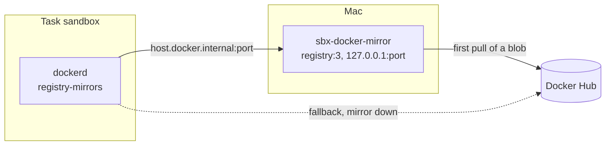

# sbx-kit-docker: Docker in a task sandbox, with an image mirror on the Mac

Status: approved by the owner on 2026-11-22 (Crit review). The builder check is done (designer's calls 6 and 7,
fact D2).

## Context

The owner moves project development into sbx task sandboxes, one kit at a time. Each kit must fit any project.
A service often starts its backing services with Docker Compose, and tests that use Testcontainers need Docker too.
So Docker comes first.

## Intent

A project runs its backing services as containers inside its task sandbox, and its tests start containers with
Testcontainers. The agent needs no setup step for this. A new task gets its images in seconds, not minutes, and the
tasks of one Mac do not each pull from Docker Hub.

## Facts (probes of 2026-11-20, sbx v0.54.0, `sbx-stack-base:0.5.1`)

The probes ran in throwaway `probe-*` sandboxes. The builder turns D2, D6, D8 and D10 into fact probes in
`tests/facts/` (see "Left to the builder").

| # | Fact | Consequence |
|---|---|---|
| D1 | Each VM runs its own `dockerd` (Docker 29.9.2, Compose 5.6.1). `agent` is in the group `docker`. sbx starts `dockerd` with the proxy settings and with no `/etc/docker/daemon.json`; `/etc/docker/` does not exist | Docker needs no install. The kit owns `daemon.json` |
| D2 | A pull needs the runtime hosts `registry-1.docker.io`, `auth.docker.io` and `production.cloudfront.docker.com` (the blobs came from there). Docker documents `production.cloudflare.docker.com` too. `postgres:16-alpine`: 12.5 s. With rules limited to `GET` and `HEAD`, the proxy reads the TLS traffic of `dockerd` (`l7-required` in `sbx policy log`), a pull works, and a `docker push` gets 403 on its `POST` ("No matching allow rule") | The kit allows the four hosts, `GET` and `HEAD` only. This also blocks a push |
| D3 | `docker compose up -d --wait` with Postgres and Valkey: 4.3 s. Published ports answer on `localhost` of the VM | No kit work |
| D4 | Testcontainers (Node, `testcontainers` latest) works: Ryuk runs, a Postgres container starts in 2 s, the mapped port answers on `localhost` | No kit work |
| D5 | A container in the VM reaches the network directly, under the same network policy: a host with no rule stays blocked | Images that fetch data at start (a virus scanner's signatures) need rules for their hosts |
| D6 | `sbx template save` does not keep `/var/lib/docker`: it is a separate volume. A stop and a start keep images and volumes | A project template cannot hold images. A cache must live outside the VM |
| D7 | The volume of `/var/lib/docker` has the size of the instance setting `sandbox.disk.dockerVolume` (default `10g`), or of `DOCKER_SANDBOXES_DOCKER_SIZE` at the create. It is a sparse file on the Mac (64 GB shown, 6.9 MB used after the create). `sbx env rm` deletes it | The README names `25g` as the setting. Size costs only what the images fill |
| D8 | With an allow rule for `localhost:<port>`, the VM reaches the Mac's `127.0.0.1:<port>` at `host.docker.internal:<port>`: through the sbx proxy, directly, and from a container. Raw TCP works both ways. `gateway.docker.internal` is the proxy only. With no rule, the proxy asks for an approval | A mirror on the Mac's loopback is reachable from the VM |
| D9 | A `registry:3` container on the Mac in proxy mode (`REGISTRY_PROXY_REMOTEURL=https://registry-1.docker.io`) serves the VM. `registry-mirrors` in `daemon.json` takes effect on `SIGHUP` to `dockerd`, with no restart, and holds after a stop and a start. Pull of `postgres:16-alpine`: 14.3 s cold, 1.85 s warm | The picked approach works |
| D10 | With the mirror down, `dockerd` falls back to Docker Hub directly (2.5 s for `valkey/valkey:8-alpine`) | A mirror failure does not block a pull |
| D11 | The sbx setting `platform.images.registryMirror` also mirrors Docker Hub pulls inside a sandbox, but it refuses a loopback host and needs a certificate that the VM trusts | Not used. Revisit if sbx accepts a loopback mirror |
| D12 | A delete of `daemon.json` and a `SIGHUP` leave the mirror in `dockerd`: a reload with no file keeps the old settings | The hook writes the file and never deletes it. To turn the mirror off, the hook would write an empty list |

## Goals, non-goals, anti-goals

- **Goal:** `docker`, `docker compose` and Testcontainers work in a sandbox with the kit, with no step by the agent.
- **Goal:** Docker Hub images come through one mirror on the Mac. A warm pull takes seconds. All sandboxes, projects
  and sbx instances of the Mac share the mirror.
- **Goal:** a pull still works when the mirror is down.
- **Goal:** the agent knows where to look when the image disk fills: the startup log warns at boot, and the agent
  context tells the agent to check the disk before it starts a stack and when a pull fails (designer's call 7).
- **Non-goal:** a cache for other registries (`quay.io`, `ghcr.io`, a private registry). Their images pull directly,
  with network rules from the project. A later version can add a mirror per registry.
- **Non-goal:** images in a project template (D6).
- **Non-goal:** a Docker Hub login in this version. The mirror pulls each image once per cache period, so anonymous
  limits matter little. A later version can give the mirror a login; it stays on the Mac.
- **Anti-goal:** a registry credential in the VM.
- **Anti-goal:** a push from the VM to Docker Hub. The rules allow `GET` and `HEAD` only.
- **Anti-goal:** a mirror that answers outside the Mac. It listens on `127.0.0.1` only.
- **Anti-goal:** a sandbox that does not start because of the mirror or the kit.
- **Anti-goal:** hidden wiring. Every step is in the kit descriptor, its recipe files, or the named host script.

## Approaches

| Approach | Verdict |
|---|---|
| **A pull-through registry on the Mac** (`registry:3` in proxy mode), set as `registry-mirrors` in the VM | **Picked by the owner.** It needs no image list, a moved tag updates by itself, and a failure falls back to Docker Hub (D10). It caches Docker Hub only |
| An image folder on the Mac: a script saves the project's images as tar files, the kit mounts the folder read-only and loads missing images at start | Covers every registry, but the image list goes stale with each compose change and each Testcontainers upgrade, and a moved tag needs a manual refresh |
| No cache: each task pulls from the registries | Simplest, but 1-3 minutes of pulls for each new task, and every task counts against Docker Hub's anonymous limits |
| The sbx setting `platform.images.registryMirror` | Refuses a loopback host and needs a trusted certificate (D11) |

## The design



### 1. The mirror on the Mac

A host script `host/sbx-docker-mirror` in the kit repo (bash, `set -euo pipefail`, bash 3.2):

| Command | What it does |
|---|---|
| `up` | Starts the container `<name>` when it does not run: `registry:3`, `--restart unless-stopped`, `-p 127.0.0.1:<port>:5000`, the named volume `<name>` for the cache, `REGISTRY_PROXY_REMOTEURL=https://registry-1.docker.io`. Does nothing when it runs with the same port. Fails with a message when it runs with another port (the message names `down`), and when another process holds the port. It never recreates a running mirror |
| `status` | Prints whether it runs, its port, and the size of its volume |
| `down` | Stops and removes the container. Keeps the volume |
| `purge` | `down`, then removes the volume |

- One mirror serves the whole Mac. `--restart unless-stopped` brings it back after a restart of Docker Desktop.
- The cache keeps a blob for the registry's default period of 7 days after its last pull (`REGISTRY_PROXY_TTL`).
- The mirror needs Docker Desktop on the Mac. Without it, `up` fails, and the sandboxes fall back to Docker Hub.
- The port is the kit arg `mirrorPort` (see "Designer's calls"). The script takes it from `--port`, default the same
  value.
- `--name <name>` sets the name of the container and of its volume, default `sbx-docker-mirror`. Only the check uses
  another name (designer's call 6).

### 2. The kit in the VM

`sbx-kit-docker`, schema 3, `kind: mixin`, descriptor `docker.yaml`, version `0.1.0`, a recipe `docker.dockerfile`
for its helper script.

- **Arg `mirrorPort`.** The loopback port of the mirror on the Mac.
- **Startup hook** `/usr/local/bin/sbx-docker-setup`, `user: "0"`, at each start:
  1. Waits for the socket of `dockerd`, at most 30 s.
  2. Creates `/etc/docker/` when it is missing. Sets `registry-mirrors` to `["http://host.docker.internal:<port>"]`
     in `daemon.json`. It keeps every other key of an existing file (`jq`). It writes the file only when the value
     changes.
  3. After a change: sends `SIGHUP` to `dockerd` and waits until `docker info` shows the mirror, at most 10 s.
  4. Warns when `/var/lib/docker` is more than 80 % full.
  5. Writes one line per action to `/var/log/sbx-docker.log`, and always exits 0. A failure leaves direct pulls,
     which work (D10).
- **Network rules, runtime:**
  - `registry-1.docker.io`, `auth.docker.io`, `production.cloudfront.docker.com`,
    `production.cloudflare.docker.com`: `GET` and `HEAD`.
  - The mirror: `localhost:<mirrorPort>` (D8). How a kit rule names a Mac port is a fact for the builder: see "Left to
    the builder".
- **Agent context:** Docker and Compose run in this sandbox. Docker Hub images come through a mirror on the Mac.
  Images of other registries need a network rule of the project; a 403 from the proxy means no rule: report it, do
  not work around it. A container that downloads data at start needs rules for its hosts too. The image disk has the
  size of the instance setting: check `df -h /var/lib/docker` before you start a stack of containers and when a pull
  fails, and read `/var/log/sbx-docker.log` for the warning of the last start.

### 3. Setup steps outside the kit (the README names them)

1. Set the size of the image disk in the instance:

   ```bash
   sbx-instance run <instance> -- settings set sandbox.disk.dockerVolume 25g
   ```

2. Start the mirror once on each Mac: `host/sbx-docker-mirror up`. The project file can also call it in
   `lifecycle.initialize`, so that each task start repairs a stopped mirror.
3. The project file allows the extra registries of the project and the hosts that its containers need at start.

## Limits (the README names them)

- Only Docker Hub images use the cache. Other images pull directly at each new task.
- A new sandbox starts with an empty image store (D6). A warm pull of all images of a project still takes some
  seconds per image.
- A container that fetches data at start (for example a virus scanner's signatures) fetches it in each new task. Such
  data is not cached.
- The mirror serves every public Docker Hub image to every sandbox of the Mac that has the mirror rule. This is the
  same reach as the direct rules.
- `sbx env rm` leaves other volumes of a sandbox behind (seen 2026-11-20: about five `sandbox-volume-*.img` files of
  about 35 MB together per removed sandbox). The Docker volume is not among them. This is sbx behaviour, not the kit's.

## The check

`tests/check.sh` runs in the `check` instance. It starts a mirror of its own (`--name sbx-docker-mirror-check`, a test
port, an empty volume), creates `check-docker` on the base image from `tests/sbxenv.yaml` with that port as
`mirrorPort`, asserts, and removes the sandbox. At its end it runs `purge` on its own mirror. It never touches the
owner's mirror, so it is safe while tasks run, and its cache starts cold, so assertion 2 proves a pull through it.

1. `docker info` shows the mirror. `/var/log/sbx-docker.log` has the write and the reload.
2. A pull of a small image goes through the mirror: the mirror's catalog (`/v2/_catalog`) lists the repository after
   the pull.
3. `docker compose up -d --wait` with one service and a published port: the port answers on `localhost`.
4. A `docker push` to Docker Hub fails at the proxy.
5. After a stop and a start, assertion 1 holds again, and the startup hook did not write the file again.
6. With the mirror stopped, a pull of an image that the VM does not hold works (the fallback).
7. A `daemon.json` with another key keeps that key after the hook.

## Designer's calls

| # | Call | Why |
|---|---|---|
| 1 | Default `mirrorPort` `29500` | Outside the `sbx-task` port blocks (30000 and up), the spike's ports (20000 and up) and the local port-forwards of the owner's projects |
| 2 | The hook merges into `daemon.json` and owns only `registry-mirrors` | Another kit or a project may need other daemon keys |
| 3 | `GET` and `HEAD` only on the Docker Hub hosts | Blocks a push from the VM; a pull needs no other method |
| 4 | The mirror is a container, not a native binary on the Mac | Docker Desktop runs on each Mac of the owner; the container needs no install |
| 5 | One mirror for the whole Mac | The cache is shared, and a public image holds no secret |
| 6 | The host script takes `--name`; the check runs its own mirror and purges it | The check must not stop, recreate or warm the owner's mirror (builder check of 2026-11-20) |
| 7 | The disk warning is a startup log line plus the agent context; no `docker` wrapper, Claude hook or status line part in this version | A disk fills during a task, but a wrapper or hook adds a moving part for a rare event. The agent context makes the agent check first. A later version can add a status line part in `sbx-stack-base` |

## Left to the builder

- **Probe first:** can a kit's `network-policy@2` rule name `localhost:<port>`, with the port from an arg? If not,
  the project file adds the rule with a `postCreate` host command (`sbx policy allow network --sandbox
  "$SBX_SANDBOX_NAME" localhost:<port>`), and the README shows it.
- **Probe:** does the startup hook run before `dockerd` listens? The wait in step 1 covers both cases; the probe sets
  the timeout.
- Turn D2, D6, D8 and D10 into fact probes under `tests/facts/`, with rows in `docs/facts.md`.
- The repo layout, the README wording, the helper names, and the rows for the kit-builder skill.
